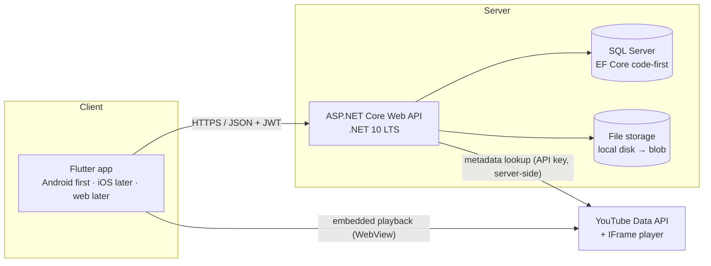
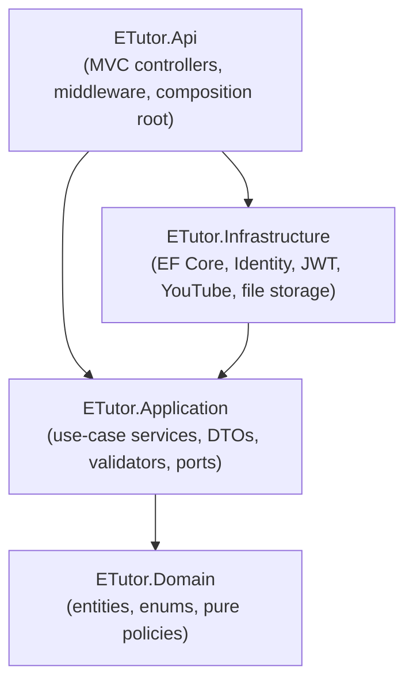
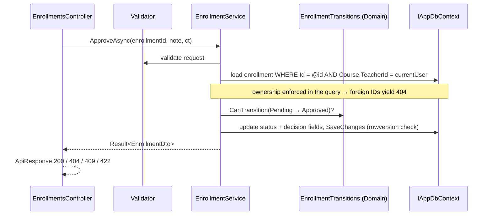
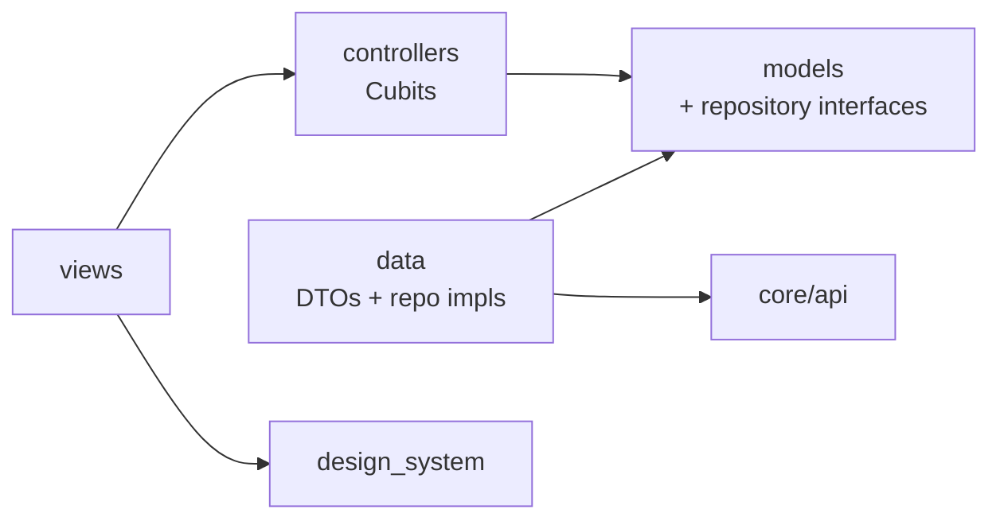

# Architecture

> Status: **PROPOSED — awaiting approval** (Phase 0). Nothing below is implemented yet.

This document explains how the platform is structured, how Clean Architecture and MVC map onto each
other in both applications, and which way dependencies are allowed to flow.

## 1. System overview



* One monorepo: `backend/`, `mobile/`, `docs/`, `scripts/`.
* The API is the **only** authority for authentication, authorization, scoring, progress and scheduling.
  The mobile app never decides access; it only reflects what the server returns.

## 2. Backend: Clean Architecture with MVC at the edge

### 2.1 Projects and dependency rule



Arrows mean "references". **Domain references nothing. Application references only Domain.** Nothing
references Api. Circular references are impossible by construction (separate projects), and an
architecture test (NetArchTest) will fail the build if a forbidden reference is added.

| Project | Contains | Must NOT contain |
|---|---|---|
| **Domain** | Entities (persistence-ignorant POCOs), enums, value objects (`LocalizedText`, `TimeRange`), **pure policies**: `ScoringPolicy`, `ProgressPolicy`, `RecurrenceCalculator`, `EnrollmentTransitions`, `SlotGrid`. | EF attributes, ASP.NET types, I/O, `DateTime.UtcNow` (time comes from `IClock`). |
| **Application** | One service per use-case area (`EnrollmentService`, `CourseContentService`, `BookingService`, …), request/response DTOs, FluentValidation validators, error codes, **ports** (interfaces): `IAppDbContext`, `IVideoProvider`, `IFileStorage`, `IClock`, `ICurrentUser`, `ITokenService`, `IEmailSender`. | Controllers, HTTP concepts (status codes), SQL Server specifics, provider SDKs. |
| **Infrastructure** | `AppDbContext`, entity configurations, migrations, seeders, ASP.NET Core Identity, JWT/refresh tokens, `YouTubeVideoProvider`, `LocalFileStorage`, NodaTime clock/time-zone adapter. | Business rules. |
| **Api** | MVC controllers, auth/authorization policies, exception handler, response envelope, rate limiting, Swagger, Serilog bootstrap, DI composition root. | Business rules, EF queries. |

### 2.2 How MVC maps onto Clean Architecture

| MVC role | Where it lives | Responsibility |
|---|---|---|
| **Controller** | `Api/Controllers` | Bind and authenticate the HTTP request → call **one** Application service method → map the `Result` to the response envelope. No `try/catch`, no queries, no rules. |
| **Model** | Domain entities + Application DTOs | Entities = the business data. DTOs = the public API contract (entities are never serialized). |
| **View** | The JSON representation (DTOs serialized by the response envelope) | There are no server-rendered views; the "view" is the documented contract consumed by Flutter. |

### 2.3 Request flow (example: teacher approves an enrollment)



### 2.4 Deliberate trade-offs

* **`IAppDbContext` instead of generic repositories.** Application services query through an interface
  that exposes `DbSet<T>` and `SaveChangesAsync`. This keeps LINQ projections (`Select` into DTOs),
  `AsNoTracking`, and pagination in the use case where the query shape is decided, which avoids
  N+1 queries and over-fetching. The cost is that Application references
  `Microsoft.EntityFrameworkCore` (the abstractions only, not the SQL Server provider). Dedicated query
  classes are introduced only where a query is reused or complex (e.g. teacher analytics, availability
  calculation).
* **Thin entities, pure policies.** Entities hold data. Rules that need no I/O (state transitions,
  scoring, recurrence expansion, slot math) live in small static or stateless Domain policies with
  exhaustive unit tests. Rules that need data (ownership, conflicts) live in Application services.
* **Results, not exceptions, for expected failures.** Services return `Result<T>` with a typed
  `Error(code, kind)` (NotFound, Forbidden, Conflict, Validation, BusinessRule). Exceptions are reserved
  for unexpected failures and are handled globally.
* **Interfaces only at real boundaries** (database, video provider, storage, clock, current user,
  tokens, email). Services are concrete classes registered in DI; they are tested with a real SQL Server
  LocalDB database rather than mocked.

### 2.5 Cross-cutting concerns

| Concern | Mechanism |
|---|---|
| Authentication | ASP.NET Core Identity (PBKDF2 hashing, lockout), JWT access token (15 min), rotating refresh tokens (30 days, stored as SHA-256 hashes, reuse detection revokes the family). |
| Authorization | Role policies (`Teacher`, `Student`) on controllers + **resource checks inside every query** through `ICurrentUser`. An `AccessQueries` helper centralizes "student has approved enrollment for course X" and "teacher owns course X". |
| Validation | FluentValidation in Application; automatic 400 with the standard envelope. |
| Errors | `IExceptionHandler` → generic 500 envelope with `traceId`; `DbUpdateConcurrencyException` → 409; unique-constraint violations mapped to specific 409 error codes. |
| Logging | Serilog, request logging with route template, status, elapsed time, `traceId` and user ID. Destructuring policy masks secrets. Stable event names (`enrollment.approved`, `booking.conflict`). |
| Rate limiting | Built-in `RateLimiter`: strict on `/auth/*`, moderate on writes, generous on reads. |
| Time | `IClock` (UTC). NodaTime for time-zone and recurrence math. All persisted instants are UTC. |
| Transactions | `SaveChanges` is atomic by default. Multi-step use cases (approve booking, submit attempt) use an explicit transaction. |

## 3. Mobile: MVC with Cubit, organized by feature

### 3.1 Folder layout

```
mobile/lib/
├── app/                 # bootstrap, DI (get_it), router (go_router), App widget
├── core/
│   ├── api/             # ApiClient (Dio), envelope parsing, AuthInterceptor, ApiException
│   ├── config/          # AppConfig (env), Branding
│   ├── errors/          # AppFailure types, error-code → localized message mapping
│   ├── logging/         # AppLogger facade, ErrorReporter, BlocObserver
│   ├── storage/         # SecureTokenStore, preferences
│   └── time/            # time-zone helpers
├── design_system/       # tokens, ThemeData builders, components (AppButton, AppCard, …)
├── l10n/                # app_en.arb, app_ar.arb → generated AppLocalizations
└── features/<feature>/
    ├── models/          # MODEL: pure Dart domain models + repository interfaces
    ├── data/            # DTOs + repository implementations (API calls, mapping)
    ├── controllers/     # CONTROLLER: Cubits + immutable state classes
    └── views/           # VIEW: screens and feature-specific widgets
```

### 3.2 Dependency rule



* **Views** render state and forward intents (`controller.submit()`). No API calls, no formatting
  logic beyond presentation, no business rules.
* **Controllers (Cubits)** own presentation state and orchestrate use cases through **repository
  interfaces**. They never import Flutter widgets or Dio, so they are tested as plain Dart with
  `bloc_test` and fake repositories.
* **Models** are immutable, framework-free Dart classes. Client-side "rules" are limited to
  presentation helpers (e.g. "is this session within 24 h"). Authoritative rules stay on the server.
* **Data** maps DTOs ↔ models and translates API envelopes into typed results. This is the only layer
  that knows about HTTP.

### 3.3 Mobile cross-cutting concerns

| Concern | Mechanism |
|---|---|
| State | `flutter_bloc` Cubits, scoped per screen via `BlocProvider`. `BlocSelector`/`buildWhen` limit rebuilds. |
| Navigation | `go_router` with typed routes, deep links, and role-aware redirects (UX only). |
| Networking | Single `ApiClient`: timeouts, retry for idempotent GETs, refresh-token rotation with a single in-flight refresh, envelope parsing into `ApiResult<T>`. |
| Tokens | `flutter_secure_storage` (Android Keystore / iOS Keychain). Never logged. |
| Localization | `gen-l10n` ARB files; server error codes mapped to localized strings. |
| Logging | `AppLogger` facade. Release builds keep warnings and above only, with no personal data. |
| Caching | Read-through in-memory cache for catalog data; offline-friendly cached "My learning" list (later). |
| Lists | Paginated, lazy `ListView.builder` / slivers; images through `cached_network_image` with sized decode. |

## 4. Performance-sensitive areas (identified up front)

| Area | Risk | Plan |
|---|---|---|
| Course outline (units → lessons → progress) | N+1 queries, over-fetching | One projected query per screen; progress joined by `(EnrollmentId, LessonId)` key. |
| Video progress heartbeats | Write amplification | Client batches every 15 s and on pause/exit; server merges into a fixed-size bitmap; one row per resource. |
| Teacher analytics / inactivity | Full scans of activity | Denormalized `Enrollment.LastActivityAtUtc` (indexed) + daily aggregates table; no raw event log. |
| Teacher discovery | Unbounded lists | Filtered, indexed, paginated query on published courses. |
| Booking approval | Race conditions | DB-enforced slot reservations (unique index) inside a transaction. See `database-design.md` §7. |
| Assessment submission | Multi-row writes | Single transaction; scoring done in memory over the loaded attempt. |

Caching is **not** introduced until a measurement justifies it. Catalog reads are the first candidate
(output cache keyed by `Accept-Language`).
