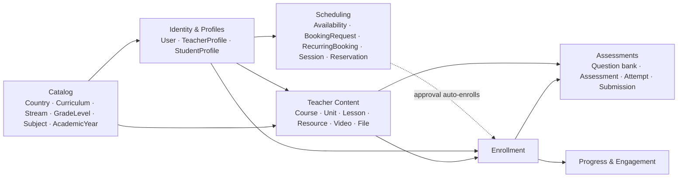
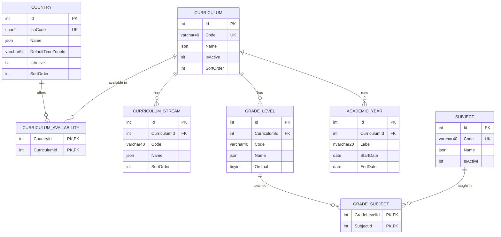
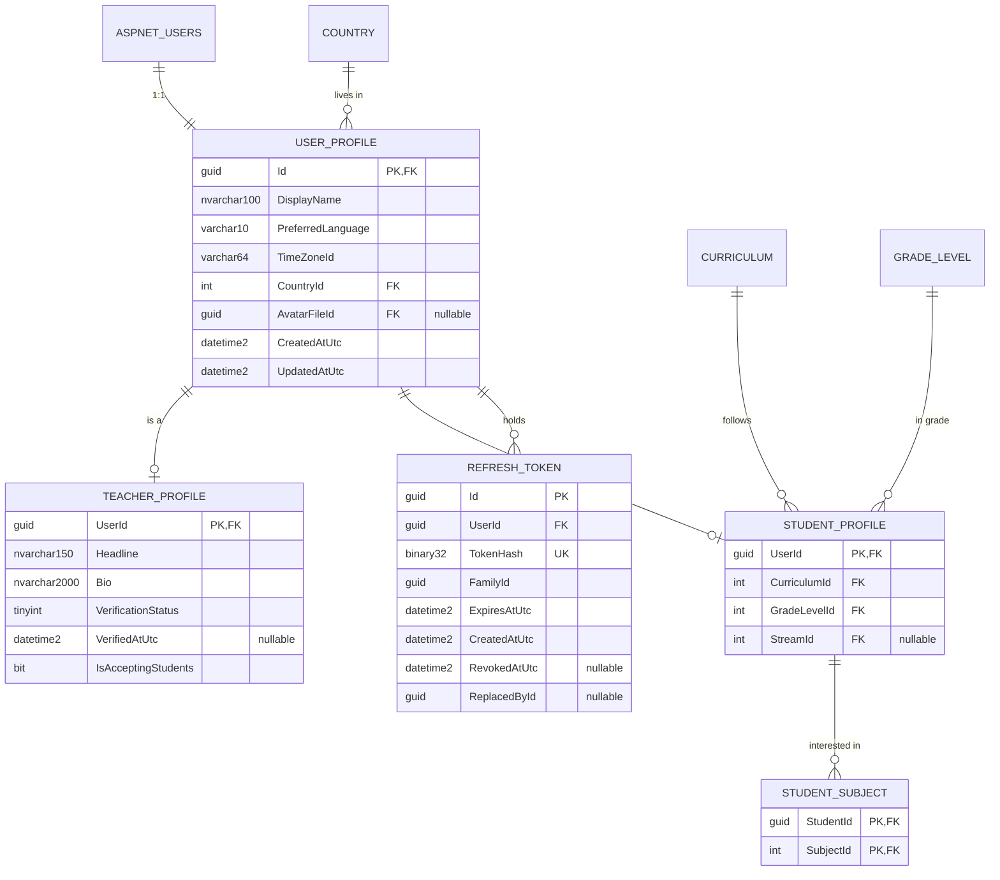
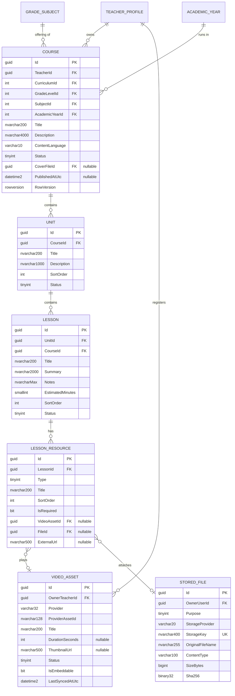
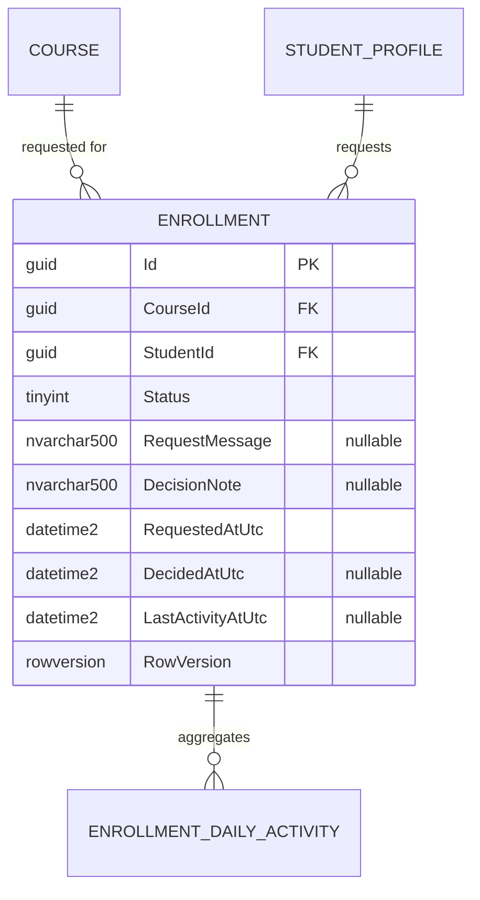
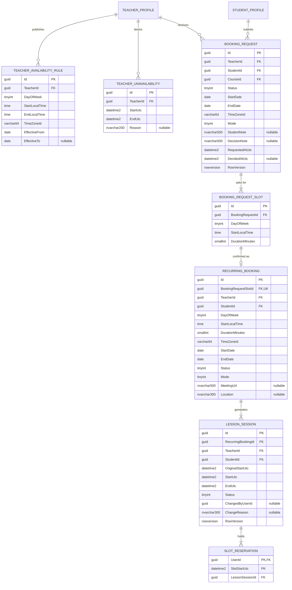
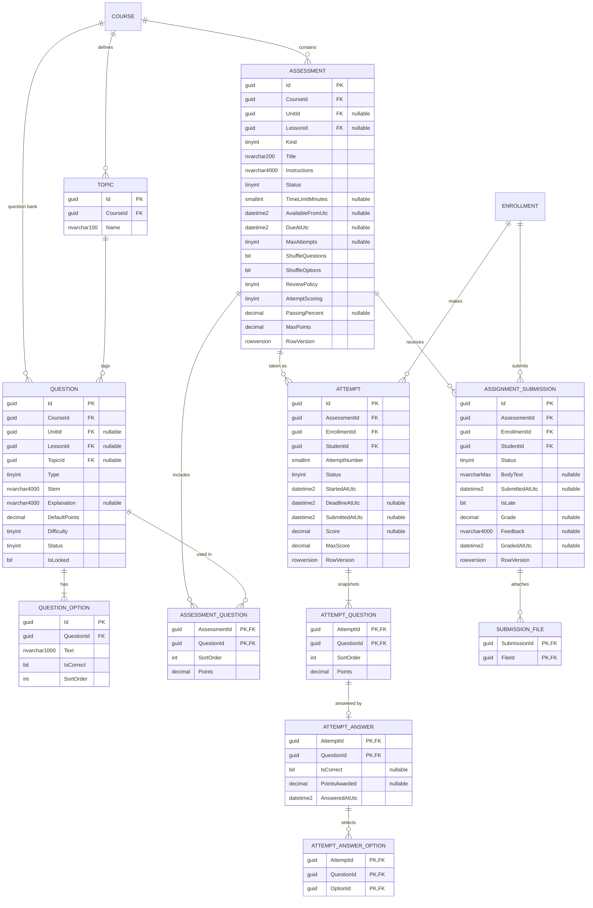
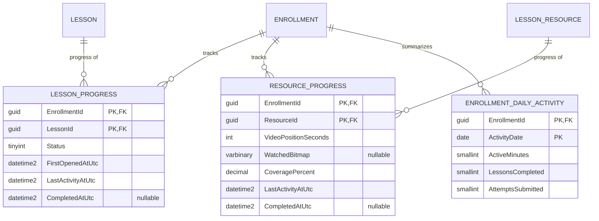

# Database Design

> Status: **PROPOSED — awaiting approval** (Phase 0). Implementation will be EF Core code-first on
> SQL Server; migrations are the single source of truth once approved.

## 1. Design principles

| Principle | Decision |
|---|---|
| Keys | `uniqueidentifier` PKs for business tables, generated by EF Core's **SQL Server-sequential GUID generator** (UUIDv7 is *not* used: SQL Server orders GUIDs by their last bytes, so v7 would fragment clustered indexes). Small reference tables (catalog) use `int IDENTITY`. |
| Time | Instants are stored as `datetime2(0)` in **UTC**, with column names ending in `Utc`. Calendar dates use `date`; wall-clock times use `time(0)`. Time zones are **IANA IDs** (`varchar(64)`, e.g. `Asia/Amman`). |
| Enums | Stored as `tinyint` with `CHECK` constraints for the valid range. |
| Text | `nvarchar(n)` with explicit max lengths everywhere. `nvarchar(max)` only for lesson notes and essay answers. |
| Localized catalog names | `LocalizedText` stored as JSON (`{"en":"Physics","ar":"الفيزياء"}`) via EF Core `ToJson`. Adding a language needs no migration. |
| Nullability | Columns are `NOT NULL` unless "unknown/not applicable" is a real state. Every nullable column is justified in the tables below. |
| Integrity across hierarchy | **Composite foreign keys** guarantee consistency, e.g. a lesson's `CourseId` must equal its unit's `CourseId`, and a student's grade must belong to their curriculum. |
| Deletes | `RESTRICT` by default. `CASCADE` only inside an aggregate (Course → Unit → Lesson → Resource, Question → Option, …). Published content with student history is **archived** (status), not deleted. |
| Concurrency | `rowversion` on records edited by more than one actor (Enrollment, BookingRequest, LessonSession, Assessment, Attempt, Submission). Conflicts surface as HTTP 409. |
| Auditing | `CreatedAtUtc` / `UpdatedAtUtc` set by a `SaveChanges` interceptor using `IClock`. |
| Scope | No tables for payments, AI, messaging, notifications or admin tooling (out of MVP). The model leaves room for them without restructuring. |

## 2. Domain map

The central idea: **the Enrollment row is the teacher–student relationship.** Progress, attempts and
submissions hang off `EnrollmentId`, so they always belong to the correct relationship, and revoking
an enrollment cleanly cuts access without deleting history.

## 3. Catalog (configurable, shared, seeded)

Decisions:

* **Curricula are not owned by a country.** `CurriculumAvailability` (many-to-many) lets
  international curricula (IGCSE, IB, American) be offered in several countries, while national
  curricula (Jordan Tawjihi, Saudi national) have a single row.
* **GradeLevel vs AcademicYear are different things.** GradeLevel = "Grade 12" (where the student is
  in the system); AcademicYear = "2026/2027" (the calendar the course runs in, with dates per
  curriculum because calendars differ by country).
* **Subjects are global** (`physics`, `mathematics`) so analytics and discovery work across curricula;
  `GradeSubject` defines which subjects exist at which grade.
* **Streams** (e.g. Tawjihi Scientific / Literary / Industrial) are optional per curriculum.

Constraints and indexes: unique `(CurriculumId, Code)` on Stream and GradeLevel; unique
`(CurriculumId, Ordinal)` on GradeLevel; unique `(CurriculumId, Label)` on AcademicYear;
`CHECK (StartDate < EndDate)`; alternate key `(Id, CurriculumId)` on GradeLevel, Stream and
AcademicYear to support composite FKs.

## 4. Identity and profiles

* ASP.NET Core Identity tables (`AspNetUsers`, `AspNetRoles`, `AspNetUserRoles`, …) live in
  Infrastructure and own credentials, lockout and **roles (the single source of truth for Teacher /
  Student)**. The Domain only sees `UserProfile`, keyed by the same `Guid`.
* `StudentProfile` uses composite FKs `(GradeLevelId, CurriculumId)` → GradeLevel and
  `(StreamId, CurriculumId)` → Stream, so a student can never be in Grade 12 of a curriculum they
  don't follow. `StreamId` is nullable because many curricula have no streams.
* `TeacherProfile.VerificationStatus` (Pending / Verified / Rejected) gates discovery: unverified
  teachers are hidden. In the MVP, verification is set by seed or SQL; there is no admin UI.
* Refresh tokens are stored **hashed**. `FamilyId` enables reuse detection, which revokes the whole
  chain. Index: `(UserId, RevokedAtUtc)`.

## 5. Teacher content, video and files

* **`Course` is the ownership boundary**: a teacher's offering of one catalog subject, for one
  grade, in one academic year. Two teachers can both teach Grade 12 Physics without interfering.
  Composite FKs enforce `(GradeLevelId, SubjectId)` ∈ GradeSubject, `(GradeLevelId, CurriculumId)`
  and `(AcademicYearId, CurriculumId)`.
* `Lesson.CourseId` is intentionally denormalized, with integrity guaranteed by the composite FK
  `(UnitId, CourseId)` → `Unit(Id, CourseId)`. Access checks and progress queries then never need
  extra joins.
* `LessonResource` is a discriminated row: `CHECK` constraint guarantees exactly the column matching
  `Type` is set (Video → `VideoAssetId`, Document → `FileId`, Link → `ExternalUrl`). Written notes
  live on `Lesson.Notes`.
* **Status**: Draft / Published / Archived. Students only ever see Published rows whose parents are
  also Published.
* `SortOrder` uses gaps (1000, 2000, …) so reordering usually updates one row. Indexes are
  `(CourseId, SortOrder)` and `(UnitId, SortOrder)`, deliberately **not unique**, because SQL Server
  cannot defer uniqueness during swaps.
* `VideoAsset` is provider-independent: `Provider` + `ProviderAssetId`, unique per
  `(OwnerTeacherId, Provider, ProviderAssetId)`. `DurationSeconds`/`ThumbnailUrl` are nullable because
  providers may not report them yet (processing).
* Discovery index: `Course (Status, GradeLevelId, SubjectId) INCLUDE (TeacherId, Title)`.

## 6. Enrollment

* Status machine (Domain `EnrollmentTransitions`):
  `Pending → Approved | Rejected | Withdrawn`, `Approved → Revoked | Withdrawn`. Terminal rows are kept
  as history; a new request creates a new row.
* **Filtered unique index** `(CourseId, StudentId) WHERE Status IN (Pending, Approved)` prevents
  duplicate or conflicting active enrollments, including under concurrent requests.
* Queue indexes: `(CourseId, Status, RequestedAtUtc)` for teachers and `(StudentId, Status)` for
  students.
* `LastActivityAtUtc` is nullable (no activity yet) and indexed `(CourseId, Status, LastActivityAtUtc)`.
  It powers "students who stopped engaging" without scanning activity data.

## 7. Scheduling and booking

The model separates four concepts that must never be confused:

| Concept | Table | Reserves time? |
|---|---|---|
| Teacher's **general availability** (weekly pattern + time off) | `TeacherAvailabilityRule`, `TeacherUnavailability` | No |
| A student's **pending request** (preferred days, multiple lessons/week) | `BookingRequest`, `BookingRequestSlot` | **No**: pending never blocks anyone |
| A **confirmed recurring schedule** | `RecurringBooking` | Via its sessions |
| Individual **session occurrences** | `LessonSession` | **Yes**, through `SlotReservation` rows |

### 7.1 Rules

* **Durations**: `CHECK (DurationMinutes IN (60, 120))` on request slots and recurring bookings. The
  allowed set also lives in Domain configuration so the API validates before the DB does.
* **Availability rules**: `CHECK (StartLocalTime < EndLocalTime)`. Overlapping rules for the same
  teacher and day are rejected by the service (merged into one window).
* **Multiple lessons per week**: one `BookingRequest` has N `BookingRequestSlot`s (e.g. Sun 17:00 1 h
  + Tue 18:00 2 h). Unique `(BookingRequestId, DayOfWeek, StartLocalTime)`.
* **Eligibility and auto-enrollment** (decision D14): any student may request private lessons for one
  of the teacher's **published** courses (`BookingRequest.CourseId`, required). When the teacher
  approves, the same transaction ensures the student has an **Approved enrollment** in that course:
  * no active enrollment → one is created as Approved;
  * a Pending enrollment → it is approved;
  * already Approved → nothing changes.

  If the teacher rejects the booking, any separate enrollment request is left untouched. Composite FK
  `(CourseId, TeacherId)` → `Course(Id, TeacherId)` guarantees the course belongs to that teacher.
* **Approval may be partial**: the teacher approves selected slots. Each approved slot becomes one
  `RecurringBooking`.
* **Sessions are materialized** at approval for the booking period (e.g. a 20-week semester × 2 slots
  = 40 rows). This makes conflict checks, cancellations and "upcoming sessions" simple, indexed
  queries. Unique `(RecurringBookingId, OriginalStartUtc)` identifies each occurrence.
* **Exceptions**: cancelling sets `Status = Cancelled` and deletes that session's reservations.
  Rescheduling changes `StartUtc/EndUtc`, keeps `OriginalStartUtc`, sets `Status = Rescheduled` and
  swaps reservations, all in one transaction.

### 7.2 Preventing double booking under concurrency

Overlap ("no two intervals intersect") cannot be expressed as a unique constraint directly, so time is
discretized into a **15-minute UTC grid** (fine enough for zones with :30/:45 offsets):

* Every confirmed session inserts one `SlotReservation` row **per participant per 15-minute cell**
  (a 1-hour lesson → 4 cells × teacher + student = 8 rows).
* `PRIMARY KEY (UserId, SlotStartUtc)` makes it **impossible at the database level** for a teacher, or
  a student, to hold two overlapping sessions.
* Approval runs in one transaction: re-check the request is still Pending (rowversion) → validate
  against availability and time off → materialize sessions → insert reservations → mark request
  Approved. If two approvals race for the same time, one commit fails with a unique-key violation.
  That transaction rolls back completely and the API returns `409 booking.slot_unavailable`.
* Pending requests insert **nothing** into `SlotReservation`, so a pending request can never be
  mistaken for a confirmed booking. The teacher's request list flags requests that conflict with
  existing reservations or with each other.
* Cost: about 160 small rows per weekly 1-hour booking per semester. These are tiny clustered-key rows,
  cheap to insert and delete.

### 7.3 Time zones and daylight saving

* A recurring booking is anchored to the **teacher's wall-clock time in the teacher's IANA zone**
  (e.g. Sunday 17:00 `Asia/Amman`). Each occurrence's UTC instant is computed per date with NodaTime.
  * Skipped local time (spring-forward gap) → shifted forward by the gap length.
  * Ambiguous local time (fall-back overlap) → earlier offset.
* Students see each session in their own zone (`UserProfile.TimeZoneId`), so their local time can
  shift when only one side observes DST. The UI flags those weeks.
* `TimeZoneId` is copied onto availability rules and bookings so that a teacher changing their profile
  time zone does not silently move existing lessons. Future, unchanged sessions can be regenerated by
  a maintenance command if time-zone rules change.

## 8. Assessments

Rules:

* **Question types (MVP)**: SingleChoice, MultipleChoice, TrueFalse. Assignments are free-response +
  files, graded by the teacher.
* **Immutability**: once a question appears in a submitted attempt, `IsLocked = 1`. Edits create a
  copy (new question), and the old one is retired. History is never rewritten.
* **Attempt snapshot**: `AttemptQuestion` freezes which questions, order and points the student got.
  Option shuffling is deterministic (seeded from `AttemptId + QuestionId`), so it needs no storage.
* **Answer-key protection**: student-facing DTOs never contain `IsCorrect` or `Explanation`. They're
  revealed only according to `ReviewPolicy` (AfterSubmit / AfterDueDate / Never). Scoring happens only
  on the server.
* **Timing**: `DeadlineAtUtc = min(StartedAtUtc + TimeLimit, DueAtUtc)`. Answers after the deadline
  are rejected (with a small grace period for network latency). Late attempts are auto-submitted
  lazily on the next read.
* **Constraints**: unique `(AssessmentId, StudentId, AttemptNumber)`; filtered unique
  `(AssessmentId, StudentId) WHERE Status = InProgress` (one open attempt at a time); unique
  `(AssessmentId, StudentId)` on submissions; `CHECK (AvailableFromUtc < DueAtUtc)`;
  `CHECK (Kind = Assignment OR MaxPoints > 0)`.
* Attempts and submissions carry both `EnrollmentId` and `StudentId`. The composite FK
  `(EnrollmentId, StudentId)` → `Enrollment(Id, StudentId)` keeps them consistent while allowing fast
  "my attempts" lookups.
* **Performance by topic** = aggregate of `AttemptAnswer` grouped by `Question.TopicId`, falling back
  to UnitId and then LessonId.

## 9. Progress and engagement

How progress is calculated (Domain `ProgressPolicy`):

| Item | Complete when |
|---|---|
| Video resource | ≥ 90 % **unique** coverage. Coverage is a bitmap with one bit per 5 seconds, merged from batched client reports, so re-watching or seeking can't inflate it. |
| Document / link | Opened **and** explicitly marked done by the student. |
| Lesson | All `IsRequired` resources complete (+ attached lesson quiz passed, if any). Opening a lesson alone sets `InProgress`, never `Completed`. |
| Course | Completed published lessons ÷ published lessons, shown together with assessment mastery (average score %), never as a single opaque number. |

* `WatchedBitmap` is nullable for non-video resources. A 2-hour video needs 180 bytes.
* "Stopped engaging" = Approved enrollment with `LastActivityAtUtc` older than N days (default 7, set
  per course later). Daily aggregates drive trend charts at bounded size: one row per enrollment per
  active day. There is no unbounded raw event log.
* Every activity write updates `Enrollment.LastActivityAtUtc` and the daily row in the **same
  transaction** as the progress change.
* Limitation: YouTube progress comes from the client-side IFrame API. It's reliable for learning
  analytics, but a modified client could spoof it. It must not be used for certification-grade proof.

## 10. Index summary (beyond PKs/FKs)

| Table | Index | Query it serves |
|---|---|---|
| Course | `(TeacherId, Status)` | Teacher's courses |
| Course | `(Status, GradeLevelId, SubjectId) INCLUDE (TeacherId, Title)` | Discovery |
| Unit / Lesson | `(CourseId, SortOrder)`, `(UnitId, SortOrder)` | Ordered outline |
| Enrollment | filtered unique `(CourseId, StudentId)` active | Duplicate prevention |
| Enrollment | `(CourseId, Status, RequestedAtUtc)`, `(StudentId, Status)` | Request queues, My learning |
| Enrollment | `(CourseId, Status, LastActivityAtUtc)` | Inactive students |
| Question | `(CourseId, Status)`, `(TopicId)` | Bank browsing, topic analytics |
| Attempt | unique `(AssessmentId, StudentId, AttemptNumber)`; filtered `(AssessmentId, StudentId) WHERE InProgress` | Attempt rules |
| LessonSession | `(TeacherId, StartUtc)`, `(StudentId, StartUtc)` | Upcoming sessions |
| SlotReservation | PK `(UserId, SlotStartUtc)` | Double-booking prevention |
| BookingRequest | `(TeacherId, Status, RequestedAtUtc)`, `(StudentId, Status)` | Request queues |
| TeacherAvailabilityRule | `(TeacherId, DayOfWeek)` | Availability lookup |
| RefreshToken | unique `TokenHash`; `(UserId)` | Token refresh |
| VideoAsset | unique `(OwnerTeacherId, Provider, ProviderAssetId)` | Duplicate prevention |

## 11. Transactions (multi-row operations)

| Operation | Rows changed atomically |
|---|---|
| Register (student/teacher) | Identity user + role + UserProfile + Teacher/StudentProfile + subject interests |
| Approve booking request | Request status + RecurringBookings + LessonSessions + SlotReservations + Enrollment (create/approve) |
| Reschedule / cancel session | Session + SlotReservations |
| Submit attempt | Answers + scores + Attempt + LessonProgress (if lesson quiz) + Enrollment activity |
| Record progress | ResourceProgress + LessonProgress + Enrollment.LastActivityAtUtc + daily activity |
| Add video to lesson | VideoAsset (if new) + LessonResource |
| Reorder content | Several SortOrder updates |

## 12. Seed data

| Kind | Mechanism | Content |
|---|---|---|
| **Reference data** (all environments) | EF Core `HasData` in migrations: versioned and reproducible | Countries: JO, SA, AE, KW, QA, BH, OM. Curricula: Jordan Tawjihi (Scientific/Literary/Industrial/… streams), the six Gulf national curricula, and International (IGCSE/A-Level, IB, American). Grades 10–12, common subjects, and the 2026/2027 academic year. All names in English and Arabic. |
| **Development/demo data** | `dotnet run -- seed-dev` (Development only; never runs in Production) | Two verified teachers, three students, published courses with units/lessons, an unlisted demo YouTube video, a question bank, sample attempts, availability and one confirmed booking. Passwords are generated and printed once, not stored in the repo. |
| **Test data** | Integration tests build what each test needs via builders. The DB is reset between tests (Respawn). | — |

Local database lifecycle commands (create / migrate / seed / reset) will be documented in
`docs/setup.md` and wrapped by `scripts/db-*.ps1`, once implemented.
